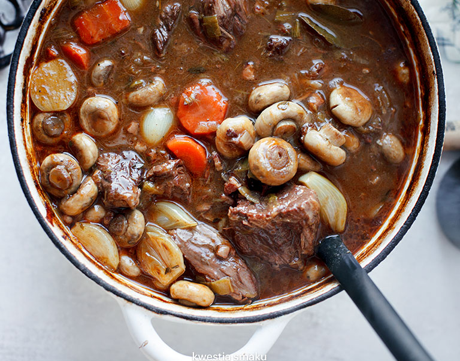

- Mięso pokroić na większe kawałki (ok. 4 - 5 cm). Na dużą patelnię z grubym dnem włożyć pokrojony w kosteczkę boczek i powoli smażyć aż do zrumienienia. Wyjąć na talerz pozostawiając tłuszcz.
- Wlać łyżkę oleju oraz dodać połowę masła, partiami obsmażyć z każdej strony kawałki mięsa, po obsmażeniu odkładać na talerz.
- Włożyć na patelnię pozostały tłuszcz i podsmażyć starty czosnek, pokrojoną na plasterki marchewkę i pora oraz drobno posiekaną cebulę. Posypać mąką, doprawić solą oraz pieprzem, jeszcze chwilę podsmażyć.
- Przełożyć składniki z patelni do większego naczynia żaroodpornego. Wlać bulion, wino, koniak oraz koncentrat, zagotować. Dodać listek laurowy, posiekane łodyżki tymianku i posiekaną natkę, następnie włożyć podsmażone mięso i boczek.
- Po ponownym zagotowaniu przykryć naczynie i wstawić do nagrzanego do 150 stopni C piekarnika. Zapiekać przez ok. 2 i 1/2 godziny. 
- Na patelni na reszcie masła podsmażyć obrane cebulki szalotki i pieczarki w całości (cebulek marynowanych nie podsmażamy). Dodać do gulaszu, wymieszać i piec tym razem bez przykrycia przez około 30 minut, do czasu aż mięso będzie już całkowicie miękkie.

*Wołowina po burgundzku będzie jeszcze lepsza jeśli przygotujemy ją dzień wcześniej.* Wówczas danie wyjmujemy z piekarnika po 2 godzinach pieczenia. Następnego dnia zagotowujemy i pieczemy jeszcze przez ok. godzinę (w połowie pieczenia odkrywamy i dodajemy podsmażone pieczarki i cebulki).

